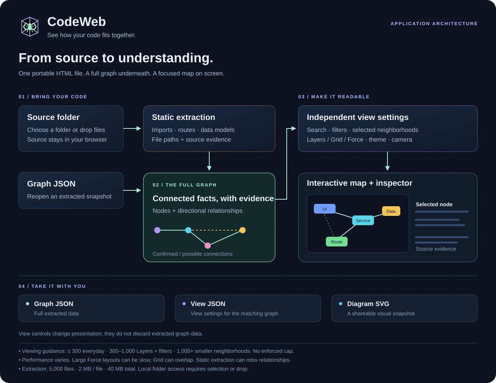

# CodeWeb architecture

See how your code fits together.

Source folders pass through static extraction; compatible graph JSON loads directly into the graph. View settings stay separate from graph data. Graph JSON preserves extracted data, view JSON saves presentation settings, and SVG captures the diagram.

**300 visible nodes is a practical viewing recommendation, not an enforced cap or a verified performance guarantee.** Filtering the view does not discard extracted graph data. Keep the full graph available through graph JSON export.

The 1,000/1,500/2,000-node checks exposed slow Force layouts and Grid overlaps. Full-map browser responsiveness at these sizes remains unverified. Node count alone cannot determine a safe limit: connection density, labels, layout, animation, browser, and hardware also affect performance.

Extraction has separate limits of 5,000 files, 2 MB per file, and 40 MB total. Static pattern extraction can miss framework routes and dynamic relationships or leave imports unresolved. The full extracted graph therefore does not imply every relationship in the source is captured.

The portable release embeds the application in one HTML file. Local folder access requires a user selection or drop. See the [README](../README.md) and [validation notes](QA.md).
